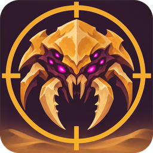
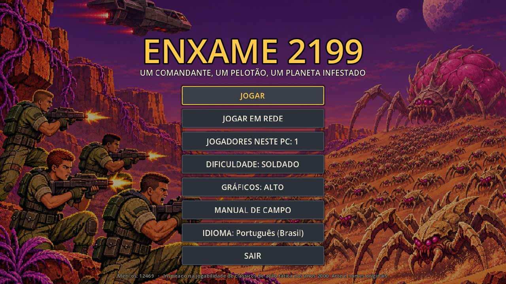
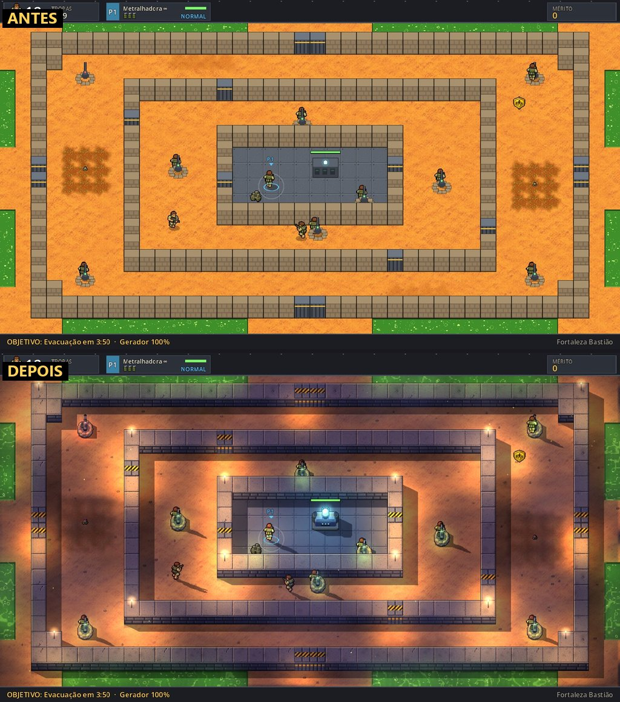
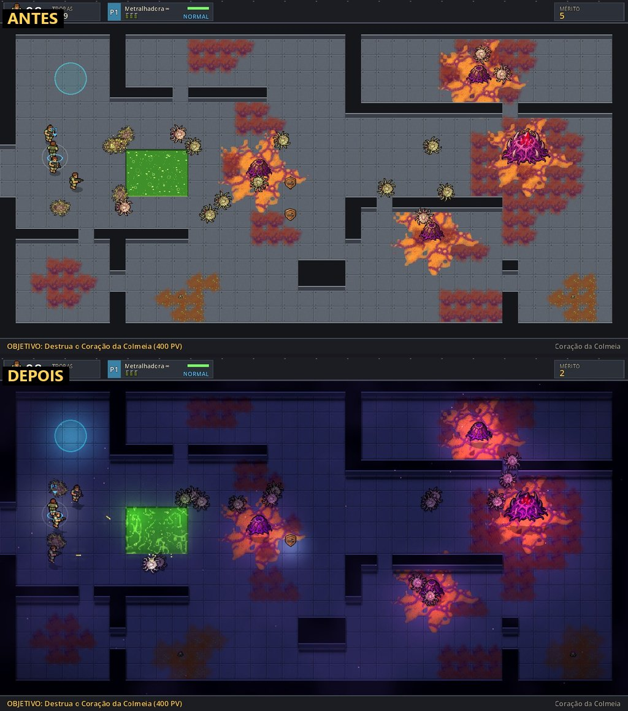
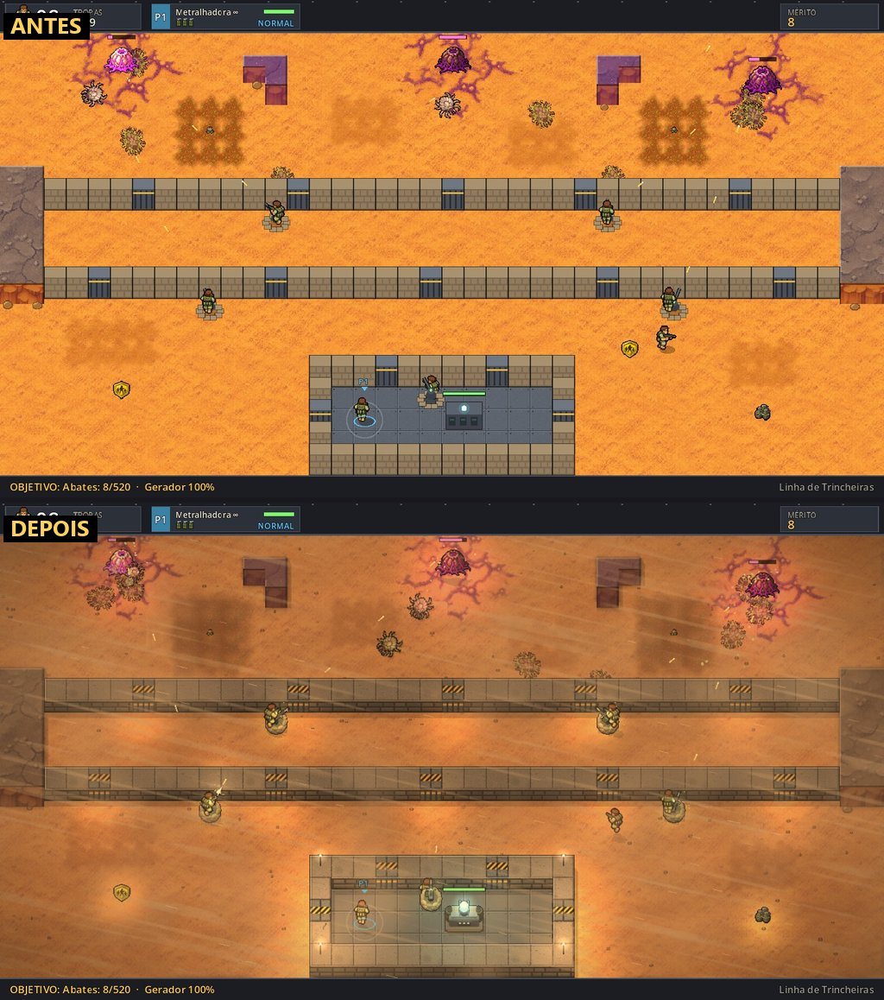
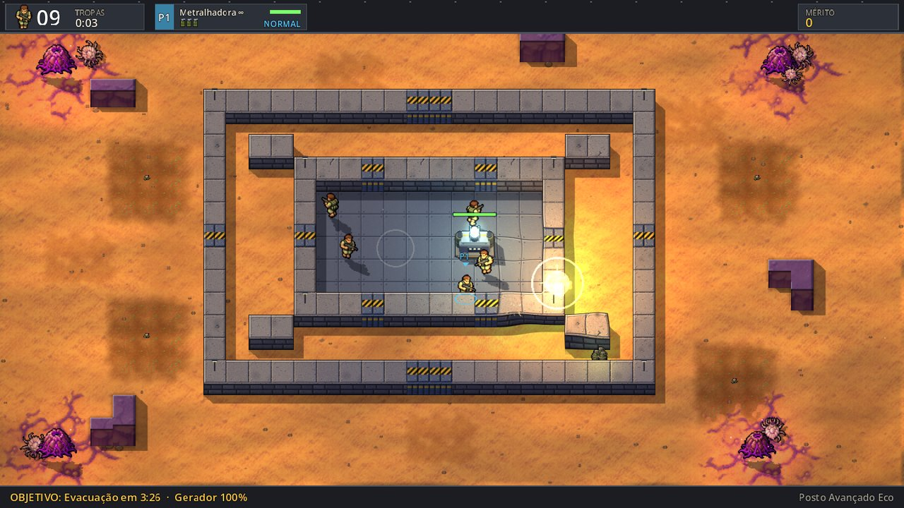
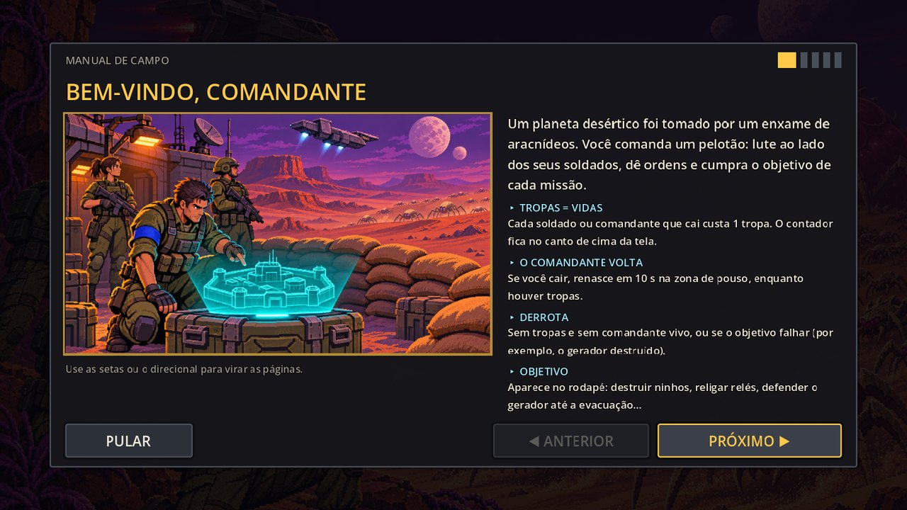
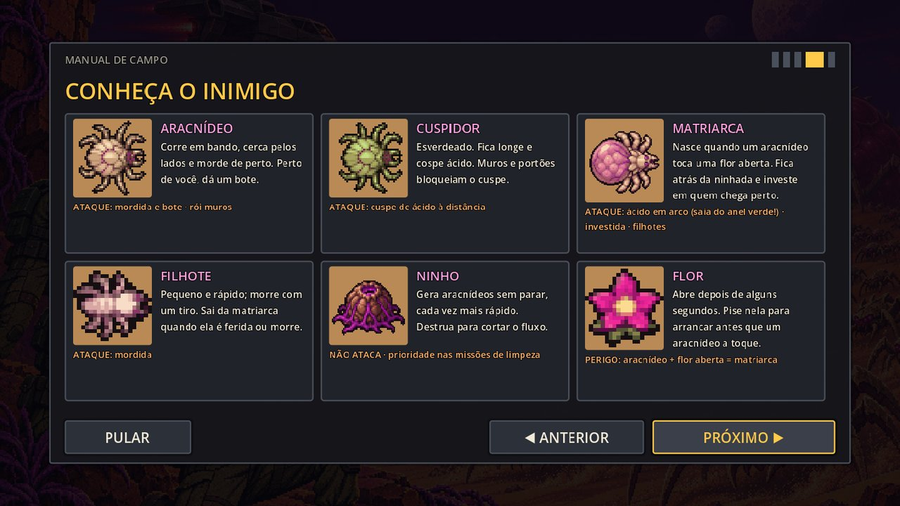
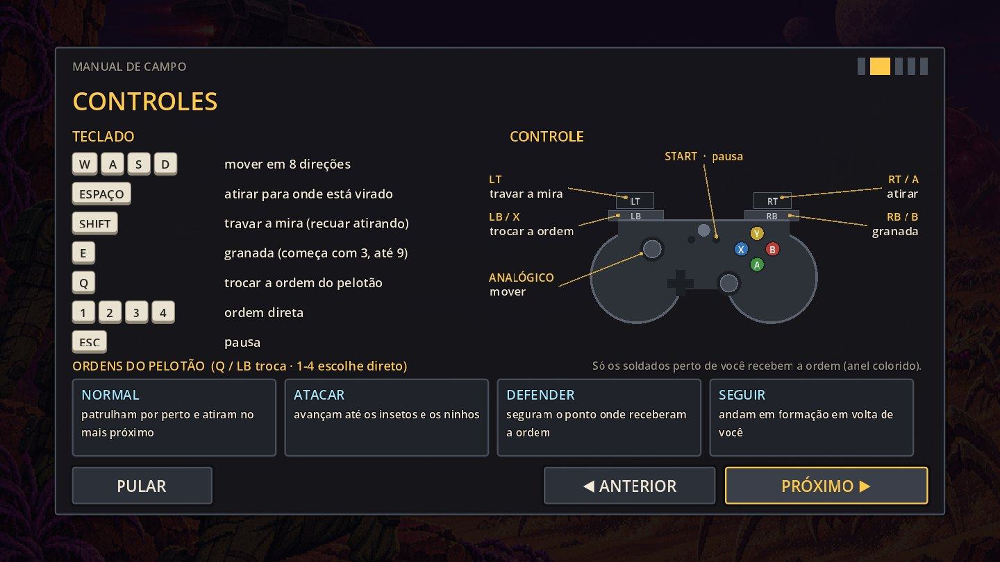

<p align="center">
  
</p>

<h1 align="center">ENXAME 2199</h1>

<p align="center">
  <b>Um comandante, um pelotão, um planeta infestado.</b><br>
  Ação tática retrô em tela fixa, feita em Godot 4.8 · até 4 jogadores no mesmo PC ou em rede · 7 idiomas
</p>

<p align="center">
  
</p>

> *English:* **Enxame 2199** ("Swarm 2199") is a retro top-down tactical shooter made in Godot 4.8. You lead a
> commander and a squad of AI soldiers against swarms of giant arachnids on a desert planet. Your troop count is
> your life bar. Up to 4 players on one PC (keyboard + controllers) or over LAN. The game runs in English,
> Portuguese (BR and PT), Spanish, German, Japanese and Simplified Chinese. All art, names and text are original.

---

## O jogo

Você é o comandante de um pelotão desembarcado num planeta desértico tomado por aracnídeos. Cada soldado vivo é
uma **tropa**, e a contagem de tropas é a sua vida: se o comandante cai e ainda há tropas, ele volta; quando as
tropas acabam, a missão está perdida. Você não controla os soldados um a um: dá **ordens** (Normal, Atacar,
Defender, Seguir) a quem está perto e cuida do resto com o seu fuzil, granadas e o apoio que cair do céu.

<table>
  <tr>
    <td></td>
    <td></td>
  </tr>
  <tr>
    <td align="center"><sub>Fortaleza Bastião: muralhas concêntricas contra um enxame contínuo</sub></td>
    <td align="center"><sub>Coração da Colmeia: a missão final, dentro da estação infestada</sub></td>
  </tr>
  <tr>
    <td></td>
    <td></td>
  </tr>
  <tr>
    <td align="center"><sub>Linha de Trincheiras: metralhadoras de ponto e uma cota de abates</sub></td>
    <td align="center"><sub>Granadas com onda de choque, fumaça, faíscas e gosma</sub></td>
  </tr>
</table>

### Destaques

- **6 missões** com objetivos diferentes: limpar ninhos, religar relés, defender o gerador, segurar a trincheira,
  resistir na fortaleza e roubar o cristal do Coração da Colmeia.
- **Pelotão com IA**: os soldados seguem ordens, ocupam metralhadoras e recuam para defender; a ordem vale só para
  quem está perto do comandante, então quem guarda uma metralhadora longe continua no posto.
- **Inimigos que mudam a partida**: aracnídeos que mordem ou cospem ácido, ninhos que aceleram com o tempo, flores
  que viram **matriarcas** se um inseto tocar nelas, emboscadas que brotam do chão e hordas pelas bordas.
- **Apoio**: reforço por terra (buggies), ataque aéreo, robô blindado, lança-chamas, canhão de plasma e granadas.
- **3 dificuldades** (Recruta, Soldado, Veterano).
- **Co-op local para 4** (dois teclados + controles) e **multiplayer em rede** (LAN ou rede virtual), com o host
  como autoridade e verificação de versão.
- **Visual com luz dinâmica 2D**: mapas de relevo nos sprites, sombras do sol, brilho, clima e hora do dia por
  missão, partículas e pós-processamento. Três níveis de qualidade.
- **Manual de campo ilustrado** antes da primeira missão: controles, co-op, ordens e cada inimigo.
- **7 idiomas**: English (padrão), Português (Brasil), Português (Portugal), Español, Deutsch, 日本語, 简体中文.

### Missões

| # | Missão | Objetivo |
|---|---|---|
| 1 | Queda Quente | Destrua os ninhos e elimine todos os aracnídeos |
| 2 | Sinal Perdido | Religue os 3 relés de comunicação |
| 3 | Posto Avançado Eco | Proteja o gerador até a evacuação |
| 4 | Linha de Trincheiras | Abata o exército inimigo e proteja o gerador |
| 5 | Fortaleza Bastião | Defenda a torre do gerador até a frota chegar |
| 6 | Coração da Colmeia | Destrua o Coração da Colmeia e recupere o cristal |

### Manual de campo

<table>
  <tr>
    <td></td>
    <td></td>
  </tr>
</table>

## Controles

<p align="center"></p>

| Jogador | Mover | Fogo | Ordem | Granada | Travar mira |
|---|---|---|---|---|---|
| P1 | WASD | Espaço / J | Q / K | E / L | Shift |
| P2 | Setas | / ou Num0 | . ou Num1 | , ou Num2 | Ctrl ou Num3 |
| Controle (Xbox) | Analógico esquerdo / direcional | RT / A | LB (ou X) | RB (ou B) | LT |

- Com **1 jogador**, qualquer teclado ou controle comanda o P1.
- Com **vários jogadores**, P1 usa WASD e P2 as setas; os controles vão primeiro para quem não tem teclado
  (P3, P4) e os que sobram vão para o P1 e depois para o P2. O briefing mostra quem está com qual aparelho.
- Teclas **1–4**: ordem direta. **Esc / Start**: pausa.

## Jogar

### Executável para Windows

Gere a pasta do jogo (tela cheia, com o ícone do projeto no `.exe`):

```bash
bash tools/build_windows.sh "D:/Jogos/Enxame2199"
```

O resultado é `Enxame2199.exe` + `Enxame2199.pck`; copie os dois juntos. Para jogar em rede, todos os PCs
precisam da mesma versão: o jogo recusa a conexão entre versões diferentes.

### Pelo Godot

Abra a pasta no Godot 4.8 ou rode:

```bash
godot --path .
```

### Em rede (LAN)

1. Um jogador escolhe **JOGAR EM REDE → HOSPEDAR PARTIDA**. O lobby mostra o IP dele (porta UDP 24565).
   Na primeira vez o Windows pede permissão no firewall: libere em **redes privadas**.
2. Os outros digitam esse IP e escolhem **ENTRAR** (até 4 jogadores, um por PC).
3. O host troca missão e dificuldade no lobby e aperta **COMEÇAR**.

Pela internet sem servidor: todos instalam uma rede virtual (ex.: Tailscale) e usam o IP dela.
Em rede a partida não pausa (Esc abre um menu por cima).

## Documentação

| Documento | O que tem |
|---|---|
| [Jornada de desenvolvimento](docs/DEVELOPMENT_JOURNEY.md) ([PDF](docs/DEVELOPMENT_JOURNEY.pdf)) | Como o jogo foi feito em três dias com IA: arquitetura, arte, playtests, rede, reforma visual, idiomas, com 29 imagens do processo |
| [GDD](docs/GDD.md) | Design completo: regras, telas, inimigos, missões, controles, contrato de assets, arquitetura, rede e visual |
| [Plano de idiomas](docs/I18N_PLAN.md) | Como funciona a tradução, etapas e o que falta (revisão nativa de ja, zh e de) |
| [Glossário de tradução](i18n/GLOSSARY.md) | Termos do jogo nos 7 idiomas e regras para tradutores |
| [Licenças dos assets](ASSETS_LICENSES.md) | Origem de cada imagem e som |
| [CLAUDE.md](CLAUDE.md) | Regras do projeto e comandos para quem desenvolve (humano ou IA) |

Comparação do visual antes e depois da reforma: [`docs/shots/before`](docs/shots/before) e
[`docs/shots/after`](docs/shots/after).

## Desenvolvimento

### Testes

```bash
godot --headless --path . -- --test
```

Valida as missões, roda cada missão com bots, testa cada pickup, flor → matriarca, cristal e extração, ordens,
aranhas presas, controles, traduções, a réplica de rede e um estresse de desempenho. Sai com código 1 se algo
falhar.

### Atalhos de depuração (argumentos depois de `--`)

```bash
godot --path . -- --mission=4 --autostart --players=2 --difficulty=dificil
```

- `--mission=N` vai direto ao briefing da missão N; com `--autostart` pula o briefing.
- `--unlockall` libera todas as missões na seleção.
- `--lang=ja` escolhe o idioma; `--manual=N` abre o manual de campo na página N.
- `--gfx=alto|medio|baixo` escolhe a qualidade gráfica só nesta execução; `--seed=N` fixa a semente da missão.
- `--shot=arquivo.png --shot-after=5 --quit-after-shot` salva um screenshot e sai.
- F9 (build de depuração): destrói todos os ninhos.

Rede com duas instâncias no mesmo PC:

```bash
godot --headless --path . -- --net-host --mission=3 --net-start-when=2 --net-log --quit-after=30
```

```bash
godot --path . -- --net-join=127.0.0.1 --net-bot --net-log --quit-after=24
```

Para medir FPS, grave a saída num arquivo (pelo pipe do terminal o número sai distorcido):

```bash
godot --path . --disable-vsync --print-fps -- --mission=5 --autostart --seed=11 --quit-after=40 > fps.txt 2>&1
```

### Estrutura

```
autoload/      Game (progresso, idioma), InputSetup (ações por jogador), Art (sprites por contrato),
               Sfx (som sintetizado), Net (ENet, lobby, RPCs, versão)
scripts/core/  Bal (todos os números de jogabilidade), L (traduções)
scripts/sim/   Grid, FlowField, SpatialHash, Missions (dados)
scripts/world/ World (loop), GroundBuilder (terreno), Projectiles, Fx, Stage (palco + pós), Lighting, Shadows,
               Ambience (clima por missão), Atmosphere (nuvens, névoa, partículas)
scripts/actors/ Commander, Soldier, Robot, Bug, Nest, Prop, Vehicle
scripts/net/   CmdInput (comandos), Snapshot (estado binário), Replica (cliente: interpolação + eventos)
scripts/ui/    Main (telas, lobby), Hud, FieldManual (tutorial), UiKit (tema)
shaders/       composição final, desfoque do brilho, ácido, silhueta de sombra, relevo plano, nuvens, névoa
i18n/          strings.csv (todas as frases, 7 idiomas) e glossário
assets/        sprites e ilustrações finais (gerados pelo pipeline)
art_src/       imagens-fonte geradas por IA (ignoradas pelo Godot)
tools/         arte (process_art, build_normals, build_structures, build_props + Blender), mapas, traduções,
               PDF da documentação, build de Windows e ícone do .exe
tests/         testes headless
docs/          GDD, jornada de desenvolvimento, plano de idiomas, screenshots
```

### Arte

Toda a arte é original. As imagens-fonte foram geradas com o Codex (gpt-image) a partir dos prompts do GDD §7 e
ficam em `art_src/codex/`; as estruturas (gerador, metralhadora, relé) foram modeladas no Blender por script.

```bash
python -I tools/process_art.py
```

```bash
python -I tools/build_normals.py
```

O primeiro regera os sprites (e o ícone) a partir das fontes; o segundo regera os mapas de relevo. Trocar
qualquer sprite = substituir o PNG em `assets/sprites/` mantendo a grade de frames do contrato. Se um PNG
faltar, o jogo desenha um substituto procedural.

Para regerar o PDF da jornada depois de editar o `.md`:

```bash
python -I -X utf8 tools/build_pdf.py docs/DEVELOPMENT_JOURNEY.md
```

## Créditos e inspiração

Jogabilidade inspirada em *Triumph! WAR 2099* (Darksun Games, 2001, freeware). Nenhum sprite, som, mapa, texto ou
nome do original foi usado: só as ideias de mecânica. Porte do MVP web
[alan-araya/shootergame.mvp](https://github.com/alan-araya/shootergame.mvp).
