# A jornada de desenvolvimento do Enxame 2199

> Como um jogo de ação tática em Godot foi feito em três dias com ajuda de IA: o que cada ferramenta fez,
> onde a direção humana foi indispensável e o que aprendemos. Os fatos vêm do histórico do Git, do
> [GDD](GDD.md), do [plano de idiomas](I18N_PLAN.md) e das ferramentas do projeto. As imagens estão em
> [`journey/`](journey/).

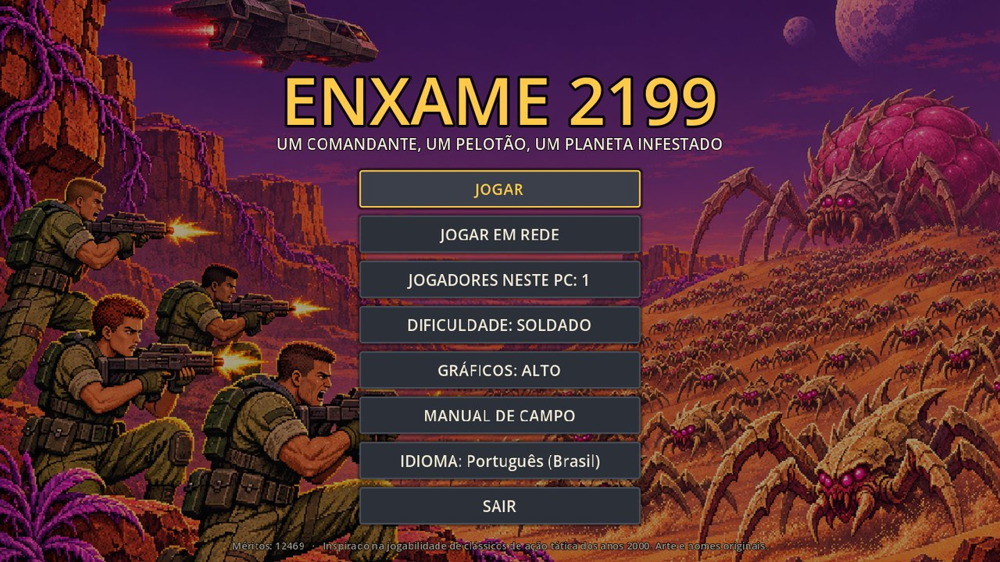
*O menu principal na versão atual (commit `16053e4`). A arte de fundo foi gerada no Codex e é a mesma desde
a primeira versão do porte.*

---

## Sumário

1. [A ideia](#1-a-ideia)
2. [O porte para Godot e a arquitetura](#2-o-porte-para-godot-e-a-arquitetura)
3. [Arte com IA](#3-arte-com-ia)
4. [A IA dos inimigos e dos soldados](#4-a-ia-dos-inimigos-e-dos-soldados)
5. [Playtests e balanceamento](#5-playtests-e-balanceamento)
6. [Multiplayer em rede](#6-multiplayer-em-rede)
7. [A reforma visual](#7-a-reforma-visual)
8. [O manual de campo (tutorial ilustrado)](#8-o-manual-de-campo-tutorial-ilustrado)
9. [Sete idiomas](#9-sete-idiomas)
10. [Como a IA ajudou](#10-como-a-ia-ajudou)
11. [Números](#11-números)

### Linha do tempo (pelos commits)

| Data | Commit | O que entrou |
|---|---|---|
| 11/11 | `fa24dab` | Porte do MVP para Godot 4.8 com arte original (5 missões, co-op local, IA nova, testes) |
| 11/11 | `2dc65b3` | Primeiro playtest: ondas nas defesas, dificuldades, IA da matriarca, missões novas |
| 11/11 | `4ae74c0` | Multiplayer em LAN (fases 0 e 1) |
| 12/11 | `857b525` | Fortaleza Bastião mais justa (mais tropas, hordas menores) |
| 12/11 | `771e4c8` | Reforma visual, etapa 0 e piloto: luz 2D, sombras, brilho |
| 12/11 | `c94c7b4` | Gosma nos impactos; clima em todas as missões (etapa 2) |
| 12/11 | `ffa3d94` | Etapa 3: estruturas modeladas no Blender, dunas |
| 12/11 | `c92e3c3` | Etapa 4: atmosfera (nuvens, poeira, névoa, esporos) |
| 12/11 | `b162296` | Etapa 5: impacto (onda de choque, fumaça, faíscas, cápsulas, aviso de dano) |
| 13/11 | `df1bfc0` | Segundo playtest: luz do entardecer mais suave, menos brilho, hordas contínuas na Fortaleza |
| 13/11 | `02401d7` | Manual de campo ilustrado (tutorial) |
| 13/11 | `5bf1616` → `4057cc4` | Plano de idiomas, extração do texto, seletor de idioma |
| 13/11 | `e3a5c3d` | Rede recusa cliente de versão diferente |
| 13/11 | `fa2b09b`, `4ccbd2d` | Controles presos ao aparelho real; P1 sempre pode usar controle |
| 13/11 | `16053e4` | Tradução para 6 idiomas; aranhas presas na rocha; RB granada, LB ordem |

---

## 1. A ideia

O ponto de partida foi um **MVP web em Three.js** ([github.com/alan-araya/shootergame.mvp](https://github.com/alan-araya/shootergame.mvp))
inspirado na jogabilidade de *Triumph! WAR 2099* (Darksun Games, 2001, freeware): um comandante e o seu pelotão,
em tela fixa vista de cima, contra enxames de aracnídeos num planeta desértico. A contagem de tropas é a vida
do jogador, e até quatro pessoas jogam no mesmo PC.

Desde o primeiro dia o projeto tem uma **regra de propriedade intelectual**, escrita no GDD §1 e no `CLAUDE.md`:

- **pode** replicar mecânicas, regras, loop de jogo, estrutura de missões e esquema de controle;
- **não pode** copiar sprites, sons, músicas, textos, mapas, logos ou nomes do original (nem de *Starship Troopers*),
  nem extrair ou traçar assets do executável do jogo antigo.

Por isso toda a arte é original: imagens geradas no Codex a partir de descrições próprias, texturas e muros
gerados por código, estruturas modeladas por código no Blender e efeitos sonoros sintetizados em tempo de
execução (`autoload/sfx.gd`). A origem de cada grupo de assets está em [`ASSETS_LICENSES.md`](../ASSETS_LICENSES.md).

---

## 2. O porte para Godot e a arquitetura

O primeiro commit (`fa24dab`) já trouxe o jogo inteiro portado para **Godot 4.8 em GDScript**: cinco missões
do MVP descritas como dados, co-op local para até quatro comandantes, pickups com buggies, nave e robô, muros,
relés e cristal, todas as telas (menu, seleção, briefing, HUD, pausa, resultado) e uma suíte de testes sem janela.

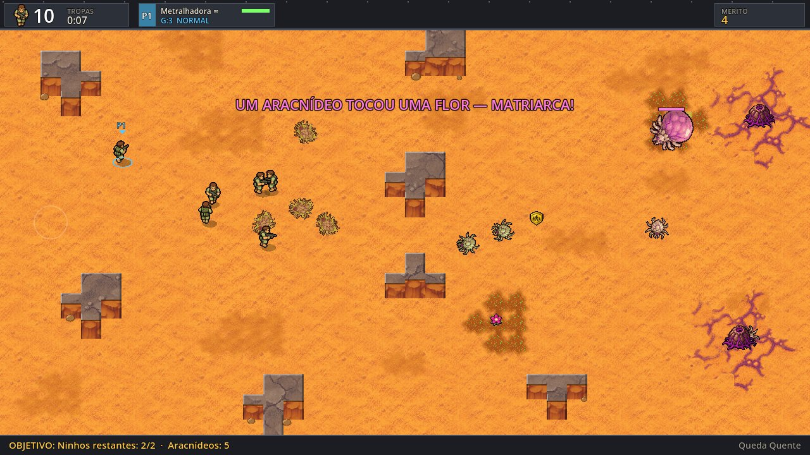
*Missão 1 (Queda Quente) como estava no primeiro commit, ainda sem luz: a arte do Codex sobre o chão plano. Captura
feita agora, numa cópia temporária do repositório no commit `fa24dab`.*

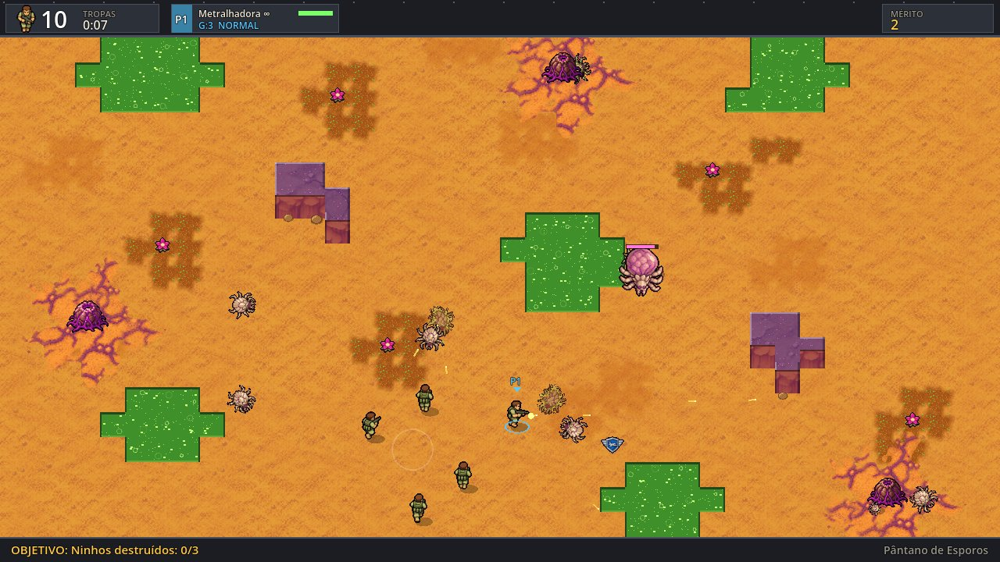
*A missão 2 original, "Pântano de Esporos", com poças verdes. Ela saiu da campanha no primeiro playtest e deu lugar
às defesas novas.*

As decisões de arquitetura que sustentaram todo o resto:

- **Simulação própria, sem a física do Godot.** Colisão de círculo contra grade (`Grid.move_circle`), hash espacial
  (`SpatialHash`) para achar vizinhos e **campos de fluxo** (`FlowField`, Dijkstra com várias fontes) para centenas
  de insetos acharem caminho até os humanos. Tudo roda em passo fixo de **60 Hz**.
- **Atores leves**: cada unidade é um `Node2D` com `tick(dt)`, chamado pelo `World` numa ordem determinística, e
  `sync_visual()` no fim do quadro. A lógica nunca lê o visual.
- **Dados separados de código**: todos os números de jogo em `scripts/core/bal.gd`; missões como mapas ASCII de
  40×20 tiles em `scripts/sim/missions.gd`, com uma função `validate`.
- **Arte por contrato de nomes** (GDD §7): o código procura `soldier.png`, `bug.png` etc. com uma grade de quadros
  combinada; se o PNG faltar, desenha um substituto procedural.

O custo dominante sempre foi o campo de fluxo. A regra que ficou no `CLAUDE.md`: um campo recalculado a cada
4 quadros, pulando os que ninguém usa. No teste de hoje a simulação custa de 0,32 a 1,22 ms por quadro conforme a
missão, e 6,3 ms no teste de estresse com 200 insetos vivos amontoados.

---

## 3. Arte com IA

### O pipeline

1. **Geração no Codex** (OpenAI, modelo de imagem gpt-image, rodando pela linha de comando no WSL). Cada pedido
   descreve uma folha de sprites com a grade de quadros do contrato, sempre **sobre fundo magenta (#FF00FF)**. As
   imagens-fonte e os registros de cada execução ficam em `art_src/codex/<asset>/`.
2. **`tools/process_art.py`** transforma a folha em sprite de jogo:
   - *chroma key* por preenchimento a partir das bordas: só o magenta **ligado à borda** vira transparente, porque os
     próprios sprites têm rosa e roxo por dentro (olhos, veias, pétalas);
   - remoção da franja rosada, recorte por grade (ou por caixas, como em `support/boxes.json`), alinhamento comum
     entre quadros;
   - redução com filtro de área, alfa binário, **contorno escuro de 1 px** e **quantização de paleta** sem
     pontilhado, para o pixel ficar nítido;
   - texturas de chão recebem uma mistura deslocada para emendar sem costura.
3. Uma regra prática saiu do uso: as chamadas ao Codex rodam **em sequência**, porque em paralelo o WSL quebrava.

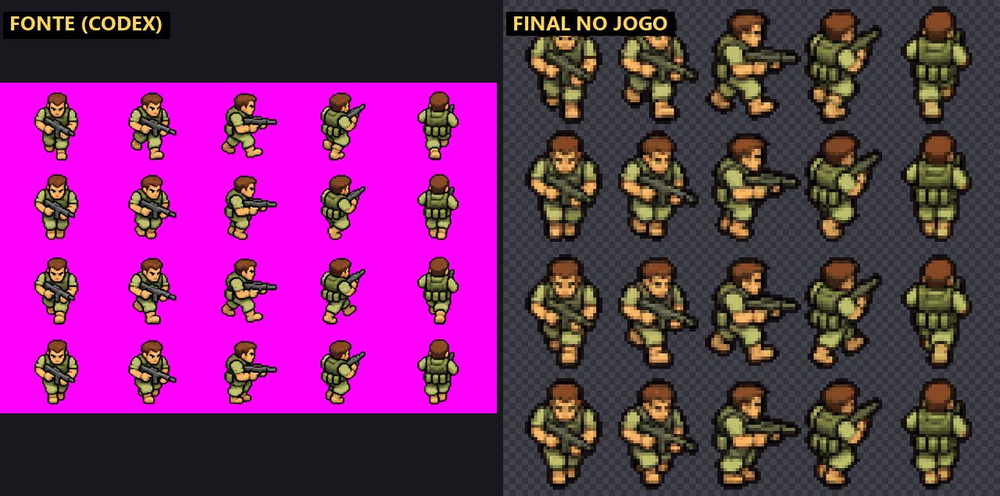
*Soldado: a folha gerada pelo Codex (5 direções × 4 passos, fundo magenta) e o sprite final de 32×40 por quadro,
ampliado 4× sem suavização. As direções para oeste são espelhadas no jogo.*

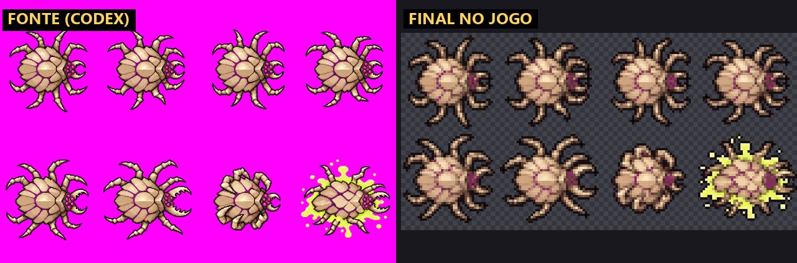
*Aracnídeo visto de cima, olhando para a direita: 4 passos, bote e morte. Quadros finais de 42×42.*

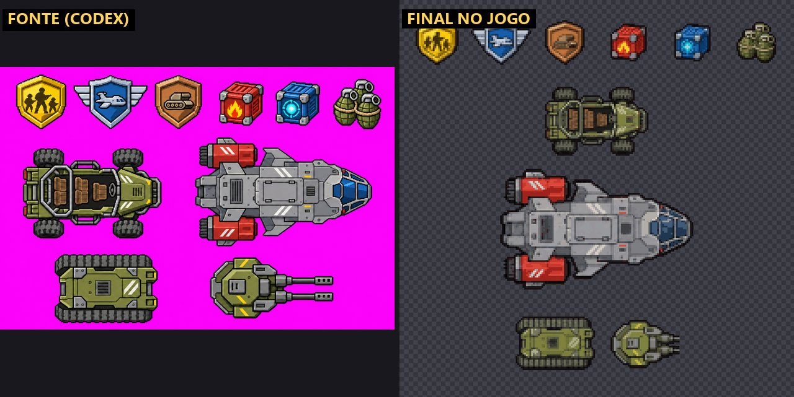
*Uma única geração rendeu os seis ícones de pickup, o buggy, a nave de transporte e o robô de apoio; o
`process_art.py` recorta cada peça pelas caixas de `boxes.json`.*

Foram oito folhas no primeiro commit (soldado, aracnídeo, matriarca, ninho, apoio, terreno, arte do menu e, mais
tarde, duas ilustrações do manual). Nenhum asset do jogo original serviu de entrada.

### Mapas de relevo

Para a reforma visual (seção 7) cada sprite ganhou um **mapa de relevo** (*normal map*) calculado por
`tools/build_normals.py`: a silhueta é "inflada" a partir da borda e o brilho de cada pixel acrescenta detalhe (o
contorno escuro vira sulco). Com isso a luz dinâmica do Godot ilumina os sprites como se tivessem volume.

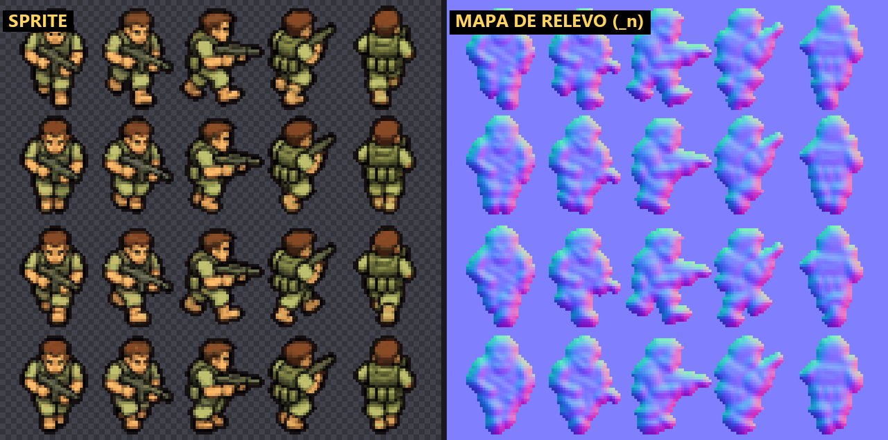
*À esquerda o sprite, à direita o mapa de relevo gerado dele (vermelho = inclinação horizontal, verde = vertical).*

---

## 4. A IA dos inimigos e dos soldados

O GDD registra que o MVP tinha uma IA fraca. O porte já trouxe uma nova (GDD §4.3):

**Soldados**
- **Alvo por ameaça**: primeiro a matriarca e os insetos perto do comandante, depois o mais próximo.
- **Sem desperdício de tiro**: evitam concentrar fogo num inseto que já vai morrer com o dano previsto.
- **Linha de tiro**: não atiram se um aliado está na frente; andam para o lado.
- **Kiting**: em Normal e Defender recuam um passo quando um inseto chega a menos de 1 tile.
- **Quatro ordens**: Normal (patrulha), Atacar (avança pelo campo de fluxo), Defender (segura o ponto) e Seguir
  (formação em anéis em volta do comandante, com espaçamento pelo ângulo áureo).
- Depois do primeiro playtest: assumem sozinhos as **metralhadoras de ponto** livres e **saem das poças de ácido**
  e do ponto onde o morteiro da matriarca vai cair.

**Insetos**
- **Papéis**: corredores que cercam pelos flancos (deslocamento lateral no campo de fluxo), cuspidores que mantêm
  distância e coletores que buscam flores.
- **Bandos**: agrupam-se antes de atacar, em vez de chegar em fila indiana.
- **Esquiva** de granadas (a proporção de insetos "espertos" cresce com a dificuldade) e **frenesi** perto de uma
  matriarca.

**A matriarca**, reescrita depois do primeiro playtest:
- fica a ~150 px dos humanos, circulando atrás da ninhada;
- dispara um **morteiro de ácido** a cada ~6 s, em arco por cima dos muros, mirando o maior grupo de humanos; um anel
  verde avisa o impacto 1,1 s antes e fica uma poça que fere;
- faz uma **investida** com empurrão quando alguém chega perto;
- abaixo de 35% de vida **recua** para o ninho; ao perder 1/3 e 2/3 da vida solta uma **ninhada de emergência**;
- no máximo três vivas ao mesmo tempo.

Uma revisão externa feita pelo próprio Codex (registrada no GDD §11) apontou falhas que foram corrigidas: cuspe
atravessando muros, relé religado sem o jogador ficar parado, soldados presos em obstáculos nas ordens Defender e
Seguir (resolvido com busca em largura), tiro através de aliado, reforço perdido no limite de 50 unidades em campo.

O último commit corrigiu um caso achado jogando: aranhas que nasciam ou eram empurradas para dentro de uma rocha
nunca mais se mexiam e travavam o objetivo "eliminar todos". Agora elas deslizam para a célula livre mais próxima e,
se continuarem presas, se autodestroem sem dar pontos — com um teste novo para o caso.

---

## 5. Playtests e balanceamento

A IA escreve código rápido, mas **não sabe se o jogo está divertido**. As mudanças mais importantes de regra vieram
de quem jogou. O ciclo foi sempre o mesmo: jogar, descrever o problema em linguagem comum, a IA traduz em
mudanças no `bal.gd` ou em `missions.gd`, adiciona um teste e mede com bots.

**Primeiro playtest** (commit `2dc65b3`, 11/11):
- as missões de defesa ficavam **paradas, sem inimigos**: entraram hordas pelas bordas até o fim, o objetivo "segurar
  até abater uma cota" e uma rede de segurança ("área segura") para defesas sem inimigos;
- as dificuldades foram recalibradas (Recruta = o antigo Soldado ~7% mais fácil, Soldado mais pressionado,
  Veterano igual) e ganharam um fator de agressividade da IA;
- a matriarca ganhou a IA descrita acima, os soldados ganharam metralhadoras de ponto;
- a campanha perdeu o pântano e ganhou duas defesas novas, **Linha de Trincheiras** e **Fortaleza Bastião**, com o Posto
  Avançado ganhando um segundo anel de muros. Os mapas em camadas saem de `tools/build_maps.py`.

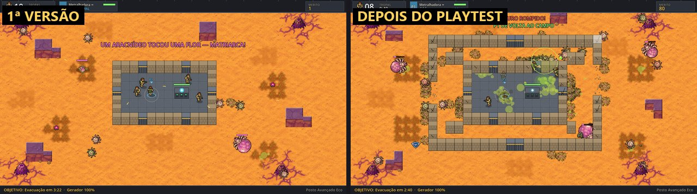
*Posto Avançado Eco: na primeira versão um único anel de muros; depois do playtest, sacos de areia + muralha. As
manchas verdes à direita são poças do morteiro de ácido da matriarca.*

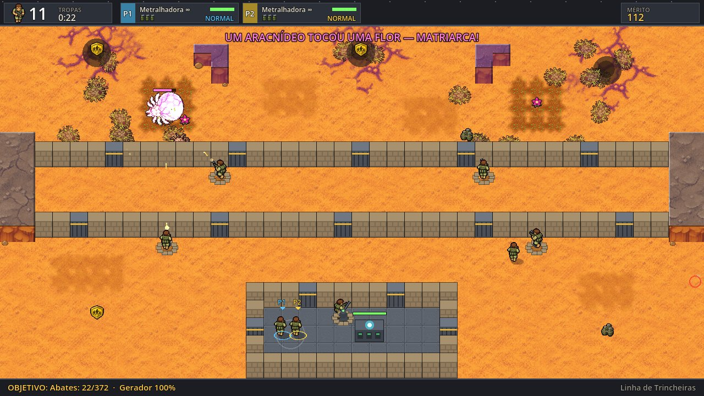
*Linha de Trincheiras, uma das missões criadas a partir do playtest: duas trincheiras com metralhadoras de ponto e
uma cota de abates.*

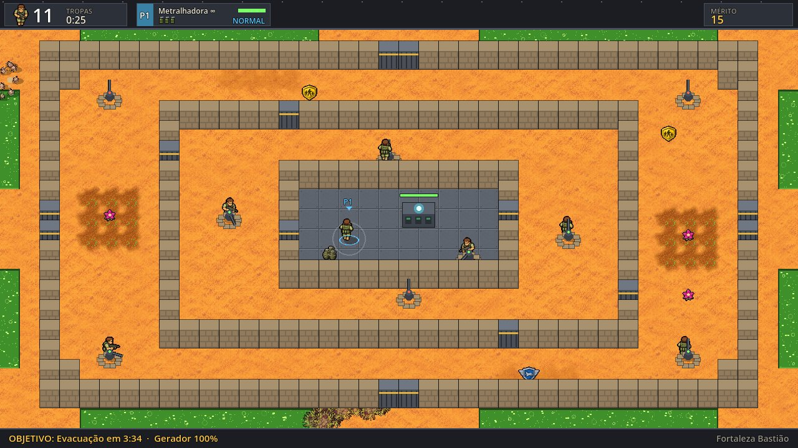
*Fortaleza Bastião: muralhas concêntricas, portões desalinhados e metralhadoras. Ainda com o visual plano da
primeira fase.*

**Ferramentas para medir em vez de adivinhar**
- `-- --test --probe`: um bot parado no gerador, um jogador, dificuldade Soldado; mede quantas vezes a defesa
  aguenta e com quantas tropas sobrando, em várias sementes (`--probe-seeds`).
- `-- --test --timeline=m3`: o estado da missão segundo a segundo.

Com elas a **Fortaleza Bastião** foi ajustada duas vezes. Em `857b525` ficou mais justa (+4 tropas, primeira horda
aos 25 s em vez de 15, grupos menores). No segundo playtest (`df1bfc0`) o pedido foi o oposto, um **enxame quase
contínuo**: a muralha externa recuou dois tiles e as hordas viraram grupos de 2–3 insetos a cada ~2 s, crescendo
42% por minuto. Resultado da sonda com 4 sementes: no Soldado, 4 vitórias em 4 com 4–9 tropas sobrando e ~950
abates (antes, 9–13 tropas e ~250 abates); no Veterano, 0 em 4.

---

## 6. Multiplayer em rede

O multiplayer em LAN (`4ae74c0`) foi feito em duas fases no mesmo dia.

**Fase 0 — separar simulação de apresentação.** Antes de qualquer rede, a simulação deixou de chamar som, partículas
e decalques diretamente. Todo efeito passa por `world.sfx()`, `world.fx.*`, `world.toast()` e `world.shake()`, que
**gravam um evento**. Isso permitiu:
- um modo `--loopback`, em que o jogo local é desenhado pelo mesmo caminho do cliente (estado + eventos), e
- um teste automático de loopback que acusa qualquer coisa que não esteja sendo replicada.

**Fase 1 — LAN com o host autoritativo** (ENet sobre UDP, porta 24565):
- o cliente manda só **comandos** de 6 bytes por quadro, com contadores para granada e ordem (um pacote perdido não
  perde o aperto do botão);
- o host manda **snapshots** binários 30 vezes por segundo (posição em meio pixel, ângulo em 1/256 de volta) — de 0,7
  a 3 KB cada, cerca de 25 KB/s por cliente — mais a lista confiável de eventos;
- o cliente monta a mesma missão com a mesma semente e desenha ~100 ms no passado, interpolando entre dois snapshots.

O teste com duas instâncias no mesmo PC (`--net-host` e `--net-join=127.0.0.1 --net-bot`) virou rotina.

**Verificação de versão** (`e3a5c3d`). Um bug real mostrou o limite do modelo: com host e cliente em builds diferentes
(antes e depois de a muralha da Fortaleza mudar de lugar), o cliente montava o mapa pelo próprio `missions.gd` e
apagava os muros que o host não listava — sumiam as muralhas verticais. A correção: o cliente envia ao conectar uma
versão (número do protocolo + impressão digital da lista de missões) e o host recusa versões diferentes com uma
mensagem clara.

Na internacionalização (seção 9) os avisos passaram a viajar como **chave + valores**, e não como texto pronto: cada
máquina traduz no próprio idioma.

---

## 7. A reforma visual

Com o jogo funcionando, a segunda fase foi a aparência. A referência era a **técnica** de jogos 2D em pixel art com
luz dinâmica (ambiente frio, luzes quentes locais, sombras longas, brilho) — a arte continua original. A reforma
foi feita em etapas, cada uma com screenshots das seis missões para comparar (`docs/shots/before` e `docs/shots/after`).
O trabalho ficou num branch separado e o estado antigo foi marcado com uma tag, para poder voltar.

| Etapa | Commit | O que entrou |
|---|---|---|
| 0 + piloto | `771e4c8` | O mundo passa a ser desenhado num palco fixo de 1280×640 e composto com brilho, cor e vinheta; luz ambiente + sol + luzes pontuais; mapas de relevo; sombras do sol; muros com volume. Piloto: Fortaleza Bastião ao entardecer |
| 2 | `c94c7b4` | Um clima por missão: a campanha vira um dia (amanhecer, meio-dia, tarde, tempestade de areia, entardecer, interior da colmeia); gosma nos impactos de bala |
| 3 | `ffa3d94` | Gerador, metralhadora e relé modelados no Blender; relevo de dunas na areia |
| 4 | `c92e3c3` | Atmosfera: sombras de nuvens, poeira e névoa com vento, vaga-lumes, esporos, ar quente ao meio-dia |
| 5 | `b162296` | Impacto: anel de luz, torrões, faíscas, fumaça que recebe luz, onda de choque na tela, cápsulas ejetadas, aviso de dano |

### Antes e depois, missão por missão

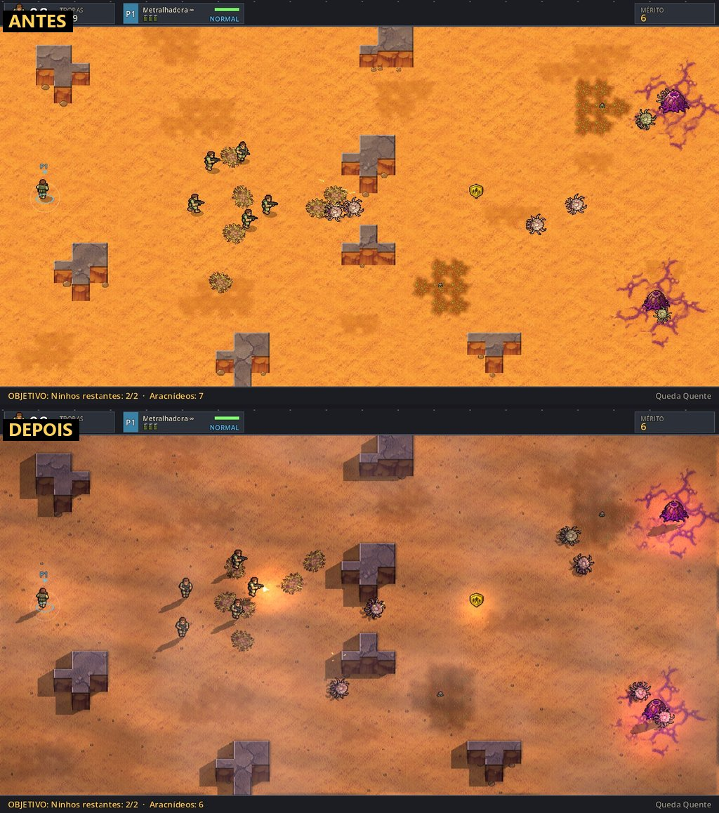
*Missão 1, Queda Quente — amanhecer.*

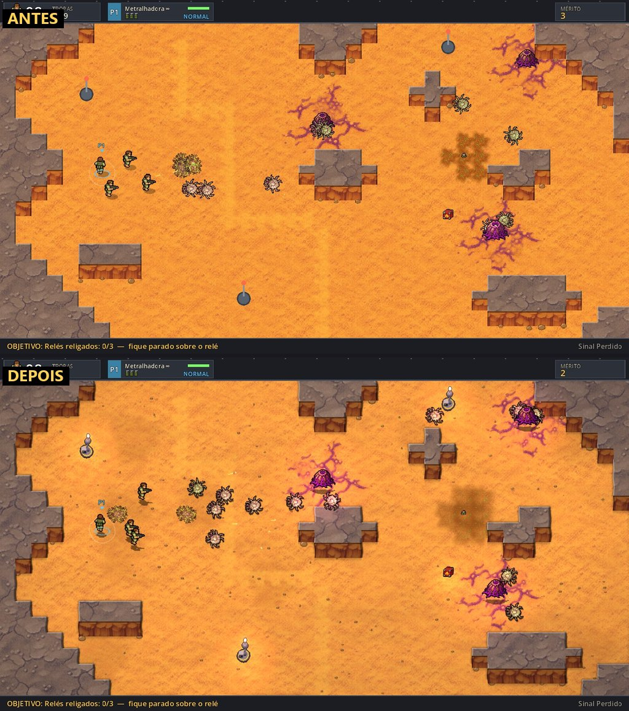
*Missão 2, Sinal Perdido — meio-dia no cânion.*

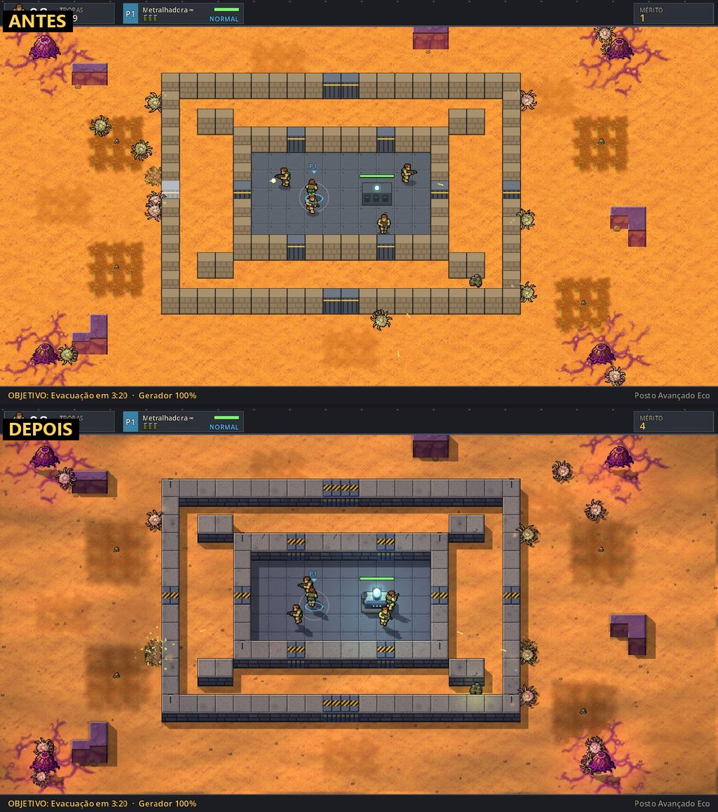
*Missão 3, Posto Avançado Eco — tarde.*

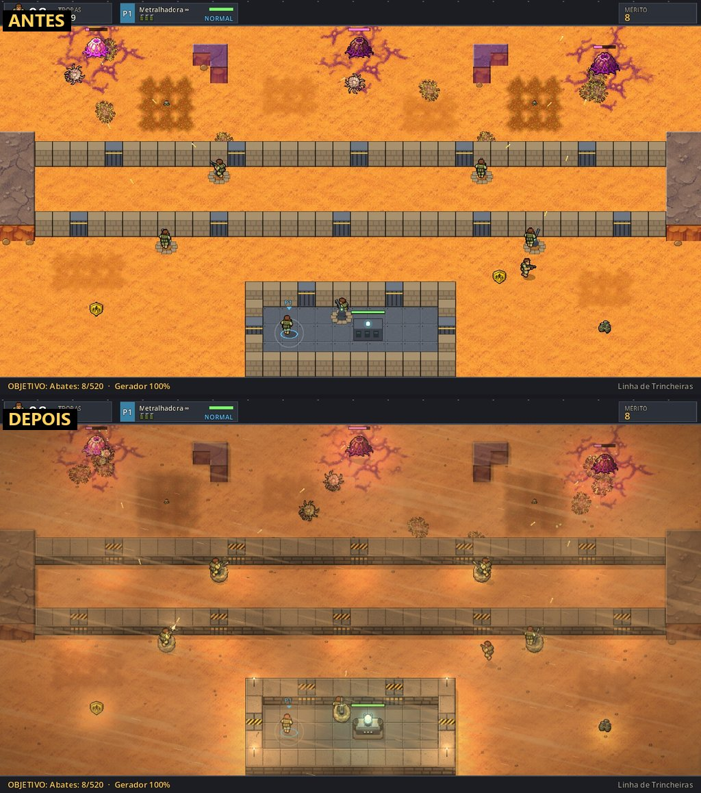
*Missão 4, Linha de Trincheiras — céu encoberto de poeira. (Depois do segundo playtest a névoa e as rajadas de areia
desta missão foram retiradas: atrapalhavam a leitura.)*

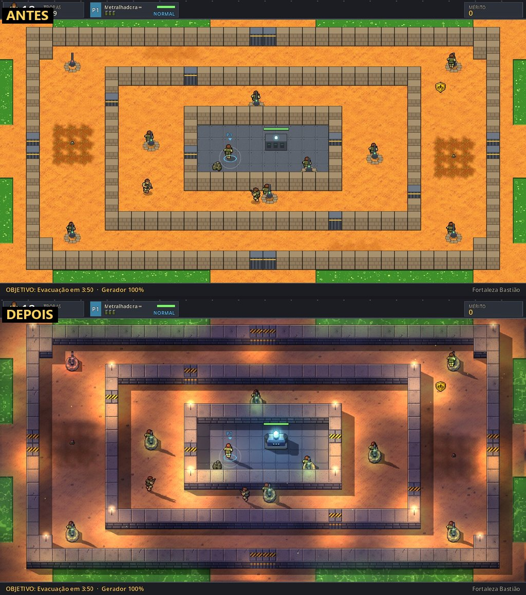
*Missão 5, Fortaleza Bastião — entardecer, com os postes nos cantos das muralhas.*

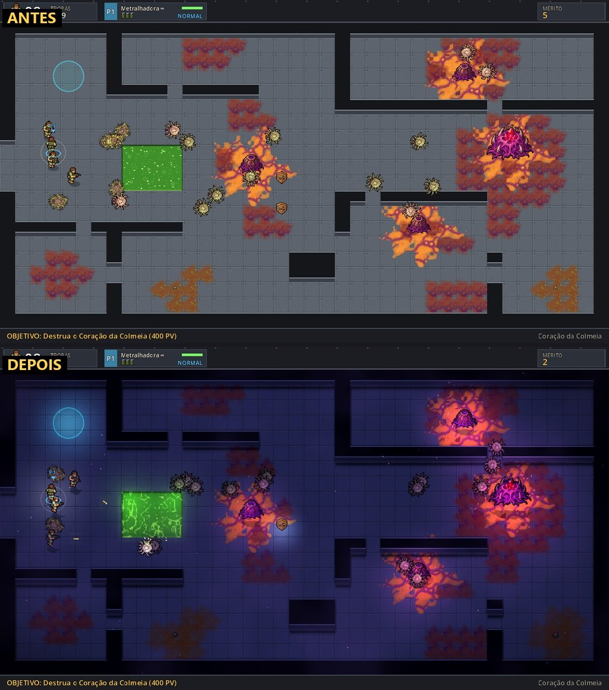
*Missão 6, Coração da Colmeia — interior escuro, com ninhos emitindo luz própria.*

O segundo playtest também pediu ajuste na luz: o entardecer estava escuro demais e os tiros brilhavam demais.

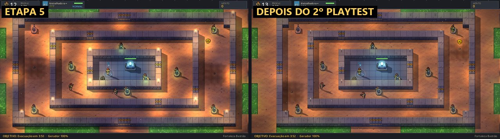
*Fortaleza ao fim da etapa 5 e depois do ajuste (`df1bfc0`): ambiente mais claro, postes a 40% com halo menor e
a muralha externa dois tiles mais para dentro.*

### Estruturas modeladas por código no Blender

Gerador, metralhadora de ponto (base + arma que gira) e relé foram **modelados por código** em
`tools/blender/props_scene.py` — formas simples, sem arquivos `.blend` nem modelos de terceiros — e renderizados com
o Blender **sem janela**, chamado por `tools/build_props.py`. A câmera ortográfica inclinada reproduz a mesma
projeção dos muros do jogo. Cada peça sai em três passes, 4× maiores que o sprite: cor chapada (a luz é a do jogo),
normais da câmera e uma máscara do que emite luz. O script reduz, limita a paleta, põe o contorno e grava
`<nome>.png`, `<nome>_n.png` e `<nome>_e.png`. Os renders brutos ficam em `art_src/blender/`.

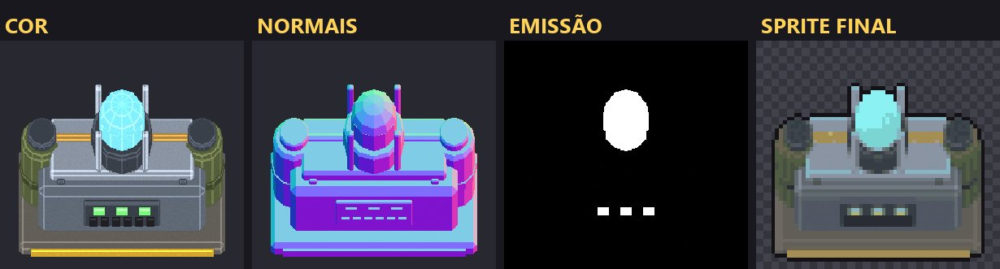
*Gerador: os três passes do Blender (cor, normais, emissão) e o sprite final. A parte emissiva é somada por cima e
continua acesa nos climas escuros.*

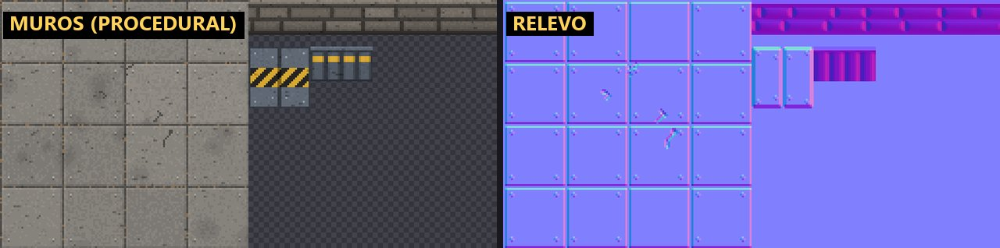
*Muros e portões: texturas geradas por `tools/build_structures.py`, com o mapa de relevo ao lado.*

### Impacto

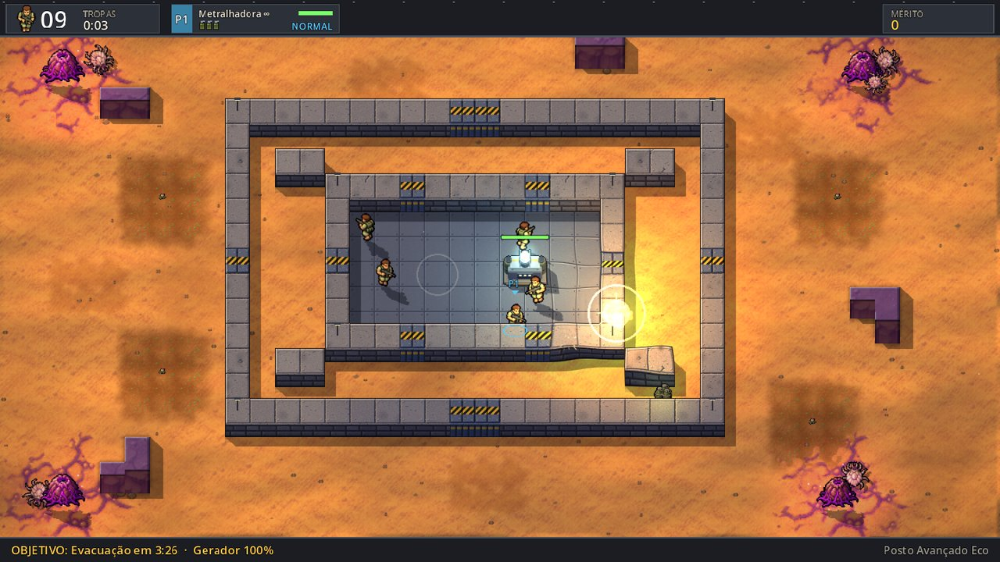
*Explosão disparada por `--fx-demo` ao lado do jogador: anel de luz, fumaça iluminada, faíscas e a onda de choque
que distorce a tela.*

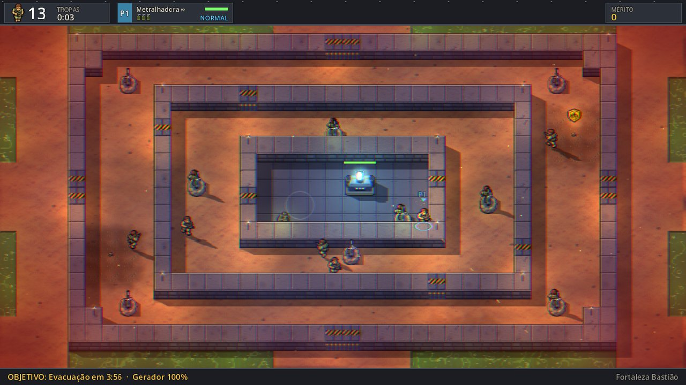
*Quando o comandante local perde vida, a borda da tela pulsa em vermelho (`--hurt-demo`). É lido do estado; a
simulação não muda.*

### A regra que manteve o visual seguro

Tudo o que é visual **só lê** a simulação: não escreve nela e não usa o gerador aleatório do mundo (`Fx` tem o
próprio). Dois testes (`_test_visuals` e `_test_effects_keep_sim`) rodam a mesma missão com e sem a parte visual e
comparam o resultado. Isso garantiu que a reforma não quebrasse a rede nem o balanceamento.

Limites e custos medidos (GDD §10): o Godot aceita 16 luzes por item desenhado, então o chão foi cortado em blocos
de 128 px e clarões próximos são fundidos. Na Fortaleza o quadro passou de ~2,7 ms para ~3,6 ms, ainda no renderizador
*Compatibility*; com tudo ligado e sem V-Sync, ~388 FPS na tempestade de areia (m4) e ~328 no entardecer (m5). Um
menu de qualidade (Alto / Médio / Baixo) desliga as partes caras.

---

## 8. O manual de campo (tutorial ilustrado)

A tela de controles virou um **manual de campo** de cinco páginas (`02401d7`), que abre sozinho na primeira vez que o
jogador começa a missão 1 e fica no menu principal. As duas ilustrações foram geradas no Codex; os prompts estão em
`art_src/codex/tutorial/prompt_*.md` e terminam com a mesma exigência: designs originais, sem texto, sem logos.

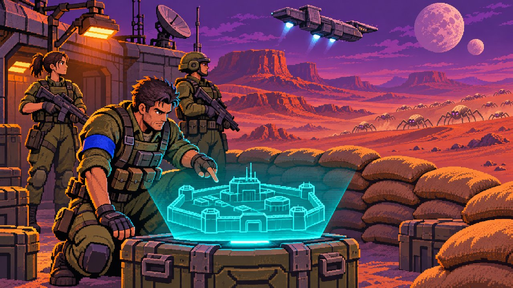
*Ilustração da página 1, gerada no Codex: o comandante diante de um mapa holográfico no posto fortificado, com o
enxame ao longe.*

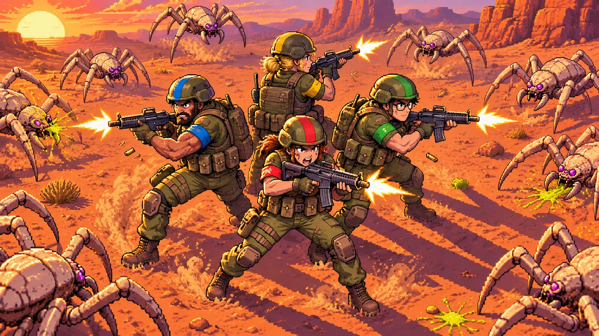
*Ilustração da página "Jogando em grupo": quatro soldados de costas uns para os outros, cada um com a braçadeira
da cor do seu jogador.*

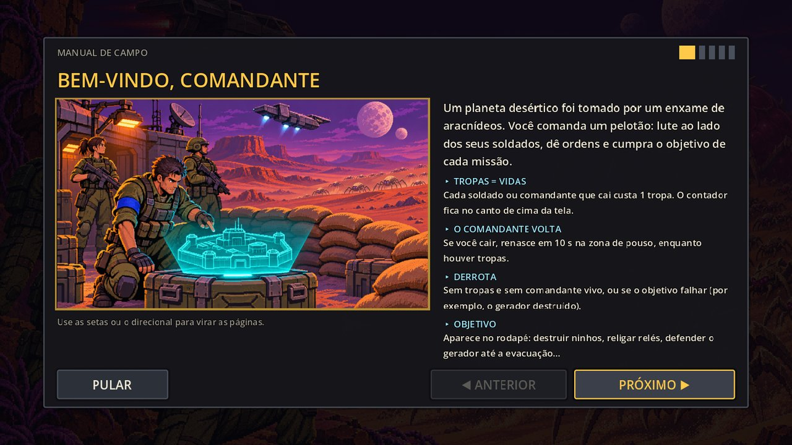
*Página 1: premissa, tropas = vidas, retorno do comandante, derrota e objetivo.*

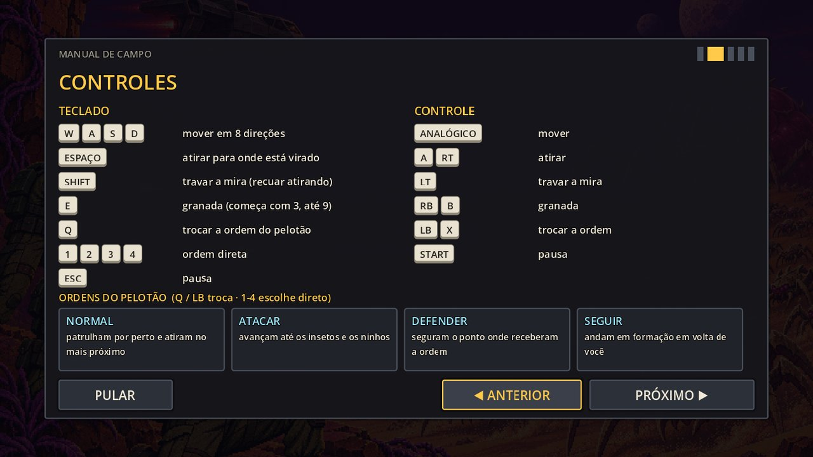
*Página 2: teclas desenhadas para teclado e controle e as quatro ordens do pelotão.*

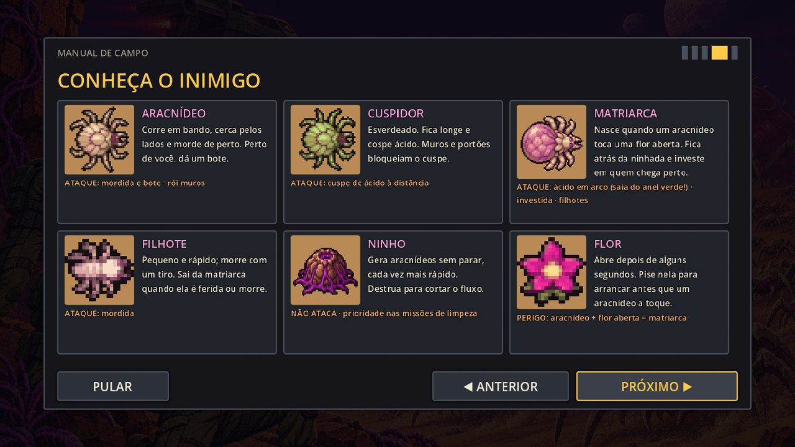
*Página 4: cada inimigo com o sprite animado do próprio jogo e como ele ataca.*

Os controles também passaram por dois ajustes vindos do uso real (`fa2b09b`, `4ccbd2d`): os controles agora são
presos ao aparelho na ordem em que conectaram, e o jogador principal sempre pode usar um. A última correção foi
conferida com um controle Xbox real via Bluetooth.

---

## 9. Sete idiomas

O jogo foi feito em português do Brasil e ganhou mais seis idiomas: inglês (EUA), espanhol latino-americano,
português de Portugal, alemão, japonês e chinês simplificado. O trabalho seguiu o plano em [`I18N_PLAN.md`](I18N_PLAN.md):

1. **Extrair** (`82a2fed`): todo texto visível saiu do código para `i18n/strings.csv`, uma linha por frase com
   chave estável (`MENU_PLAY`, `M5_BRIEF_2`), e aparece com `L.t("CHAVE", {valor = x})`. Um teste acusa chave sem texto.
2. **Sistema** (`4057cc4`): idioma salvo, idioma do sistema na primeira execução, botão no menu, `--lang=xx`.
   Japonês e chinês aparecem no Windows pela fonte do sistema; embutir Noto CJK ficou para um lançamento em Linux.
3. **Traduzir** (`16053e4`): 276 frases em cada idioma, seguindo o [glossário](../i18n/GLOSSARY.md) — que fixa
   termos (matriarca → *matriarch*, *Matriarchin*, マトリアーク, 母巢虫…), tom militar, maiúsculas e o que não se traduz
   (o nome do jogo, nomes de teclas). Os rascunhos foram feitos por IA, um tradutor por idioma em paralelo, e juntados
   por `tools/merge_translations.py`, que recusa um idioma com frase faltando ou com `{valor}` diferente.
4. **Conferir**: um teste confere os `{valores}` dos sete idiomas e as telas de menu, briefing, manual e HUD foram
   fotografadas em todos eles, sem texto cortado.

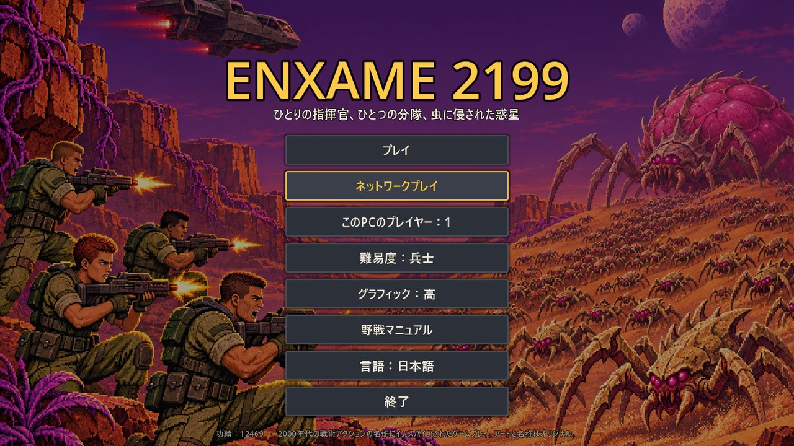
*Menu principal em japonês.*

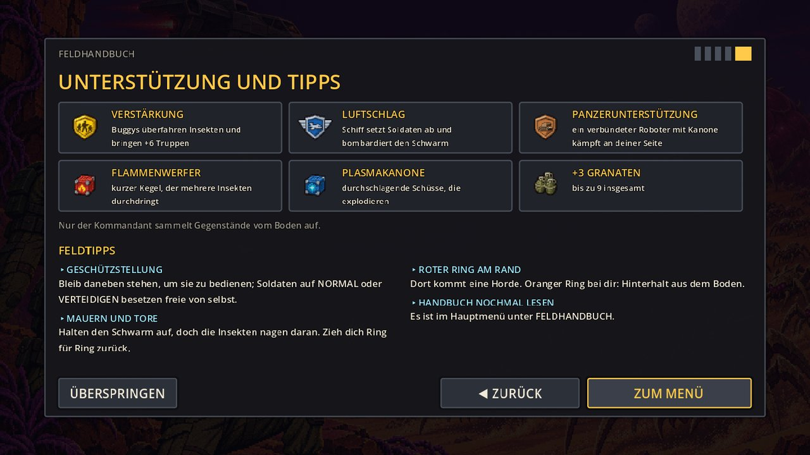
*Página de apoio e dicas em alemão, o idioma que mais estica o texto.*

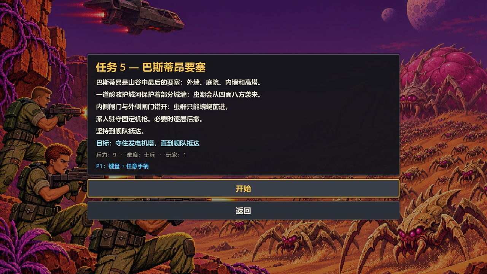
*Briefing da Fortaleza Bastião em chinês simplificado.*

**Pendente**: japonês, chinês e alemão são **tradução preliminar** até revisão de um falante nativo; as telas de
rede e de resultado ainda não foram conferidas em todos os idiomas.

---

## 10. Como a IA ajudou

### Os papéis

| Ferramenta | Papel |
|---|---|
| **Claude Code** | Desenvolvedor principal: escreveu o código GDScript, os shaders e as ferramentas Python, os testes e a documentação, e fez os commits (as linhas `Co-Authored-By` registram os modelos usados em cada etapa). Rodava o jogo sem janela para testar e com janela para tirar screenshot e **olhar o resultado** a cada mudança visual. |
| **Codex (OpenAI)** | Gerador de imagens (folhas de sprites, arte do menu, ilustrações do manual) e revisor externo do código (a revisão registrada no GDD §11). |
| **Blender sem janela** | Renderizador das estruturas 3D, comandado por scripts que a própria IA escreveu. |
| **Subagentes em paralelo** | Tarefas independentes divididas entre vários agentes ao mesmo tempo, por exemplo um tradutor por idioma. |
| **O dono do projeto** | Direção: a ideia, a regra de IP, os playtests, o que estava chato, fácil, escuro ou confuso, e as decisões de produto (espanhol latino, chinês simplificado, manter o nome do jogo). |

### O que funcionou

- **Testes e screenshots a cada passo.** A suíte cresceu junto com o jogo (de 32 verificações no porte para 99) e todo
  commit diz quantas passam. Mudança visual sem screenshot não era considerada pronta (`CLAUDE.md`, regra 6).
- **Regras escritas para a IA.** O `CLAUDE.md` concentra o que não pode ser esquecido: balanceamento só em `bal.gd`,
  missões só em `missions.gd`, nada de texto no código, efeitos só por `world.sfx()` e companhia, o visual só lê a
  simulação. Cada regra nasceu de um problema real (por exemplo, campos de fluxo recalculados todo quadro).
- **Ferramentas de diagnóstico próprias** (`--probe`, `--timeline`, `--loopback`, `--shot-all`, `--seed`,
  `--fx-demo`) transformaram "acho que está difícil" em números e "acho que está bonito" em imagens comparáveis.
- **Arte em pipeline, não à mão.** Como cada sprite sai de um script, trocar uma folha do Codex ou mexer no Blender
  regenera tudo com um comando, incluindo os mapas de relevo.
- **Arquitetura pensada para o futuro.** Separar simulação de apresentação no início tornou viáveis a rede e a reforma
  visual sem reescrever a lógica.

### O que precisou de direção humana

- **Diversão e dificuldade.** Defesas sem inimigos, a Fortaleza fácil demais e depois "quero um enxame contínuo": tudo
  isso veio de jogar. A IA sabe medir, mas não sabe o que é gostoso de jogar.
- **Gosto visual.** O entardecer escuro demais, o brilho dos tiros, a névoa que atrapalhava nas trincheiras.
- **Bugs de uso real.** Muros sumindo com builds diferentes na rede, o controle indo para o jogador errado com quatro
  pessoas, aranhas presas na rocha.
- **Decisões de produto e de idioma**, e a revisão nativa das traduções, que ainda está pendente.

### Lições

1. Escreva as regras do projeto num lugar que a IA lê sempre; elas valem mais do que repetir instruções.
2. Peça teste para cada mecânica nova e screenshot para cada mudança visual — e olhe as imagens.
3. Dê à IA formas de medir (bots, sondas, linhas do tempo, perfis de desempenho).
4. Separe simulação de apresentação cedo; isso paga a rede, o visual e os testes.
5. Jogue. O playtest humano foi o que mais mudou o jogo.

---

## 11. Números

Medidos no commit `16053e4` (13/11/2026).

| Item | Valor |
|---|---|
| Período | 11 a 13 de novembro de 2026 (primeiro commit 11/11 21:28, último 13/11 18:38) |
| Commits | 18 |
| Arquivos no repositório | 239 |
| GDScript | 38 arquivos, 10.621 linhas (8.838 sem linhas em branco e comentários) |
| Shaders | 7 arquivos, 198 linhas |
| Ferramentas Python | 7 scripts, 1.347 linhas |
| Testes | 99 verificações em 22 grupos (`tests/sim_tests.gd`, 700 linhas), 0 falhas |
| Evolução dos testes | 32 no porte → 71 → 76 → 80 → 90 → 95 → 96 → 99 |
| Missões | 6, com 6 climas (amanhecer, meio-dia, tarde, tempestade, entardecer, colmeia) |
| Textos | 276 frases × 7 idiomas |
| Imagens geradas no Codex | 9 (7 folhas/artes + 2 ilustrações do manual) |
| Estruturas do Blender | 4 peças × 3 passes = 12 renders |
| Simulação | 0,32–1,22 ms por quadro conforme a missão; 6,3 ms com 200 insetos |
| Quadro com a reforma visual | ~3,6 ms (antes ~2,7 ms) na Fortaleza; ~328–388 FPS sem V-Sync |
| Rede | snapshots de 0,7–3 KB a 30 Hz, ~25 KB/s por cliente |

---

*As capturas do estado atual e da primeira versão foram tiradas para este documento em cópias temporárias do
repositório (commits `16053e4` e `fa24dab`). As comparações de antes e depois da luz vêm de `docs/shots/`, e as das
missões novas, de `docs/screenshots/`.*
